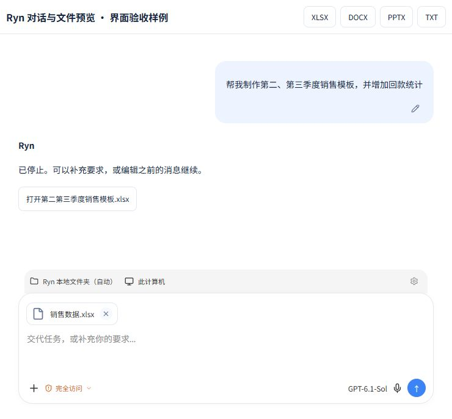
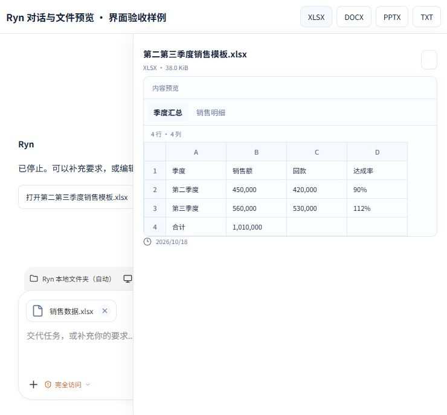

# 对话附件、停止与编辑、常见文档预览验收

日期：2026-10-18。生产源码已冻结，可并入统一打包；本机客户端安装更新由协议对齐聊天接续。

## 完成内容

- 输入框支持选择文件、浏览器拖放、Windows Tauri 原生拖放、粘贴图片，以及附件缩略图和移除。每次最多 8 个文件、4 张图片，单文件 10 MiB、合计 20 MiB。
- 附件实际随新建任务及后续消息发送，原文件保存在任务工作目录；文档摘录进入模型上下文，API/Codex 的图片走真实视觉输入。附件可单独发送。
- 停止当前轮会保留已收到的回复并进入可继续状态，下一条消息自动开始新一轮。输入草稿存在时，停止与发送按钮同时可用。
- 历史用户消息可原位编辑并保存发送。后续对话从编辑处重新生成，模型续传使用新的会话标识；运行中的编辑先停止旧操作并结算，再执行替换。原分支和操作回执保留为审计记录。
- 网络失败、请求恢复及切换聊天时，附件保持在所属草稿；已确认发送的附件会清除，恢复拒绝后保留原文件。
- Excel 支持工作表切换、行列定位、已缓存的公式结果；Word 支持段落、表格、基本格式和内嵌图片；PPT 支持分页文字与图片；CSV/TSV 支持表格；TXT 支持 UTF-8、UTF-16、GB18030。
- 编辑后的运行时长、工具计数、流式内容按新分支计算，保留历史回复原来的模型标记。之前模型或数据范围切换排除的内容继续保持排除。

## 验证

- 前端组合：10 个测试文件、156 项通过，覆盖对话、附件、请求恢复、Office 预览及 API 请求。
- 最终定向复核：3 个测试文件、28 项通过，包含新增的分支流式内容与模型来源标记测试。
- 最终后端组合：`test_agent_conversation_controls.py`、`test_agent_input_attachments.py`、`test_agent_file_preview.py`，35 项通过。
- 另外完成运行时/HTTP/状态/原生 Codex 输入回归，相关专项通过；可选真实 CLI 测试有 1 项跳过。
- `npm run build` 通过（TypeScript + Vite）。现有通知模块混合导入和 bundle 大小提示仍存在。
- 修改范围 `git diff --check` 通过；新增 Python 模块及后端控制代码 Ruff 通过。
- 使用真实仓库 XLSX/DOCX/PPTX 文件检查解析，并在隔离浏览器组件页检查工作表切换、PPT 翻页、Word/TXT 阅读、历史消息保存及停止。

## 范围与限制

- Office 预览展示内容及基本结构，复杂图表、对象和原始分页排版可能与原应用不同。未保存计算结果的公式会显示公式，交给 Excel 计算。
- 旧版 XLS/DOC/PPT、ODF、RTF 使用节点上的 LibreOffice 转换；当前机器未安装时会明确提示下载原文件。
- Antigravity/Claude 的文本 CLI 模式仍受其原有图片接口限制；API 与 Codex CLI 已接入视觉图片输入。
- 浏览器截图来自真实 UI 组件和模拟样例内容，体现界面交互；真实文件读取接口、附件保存和控制状态由后端测试覆盖。截图不代表本机已安装新版，也不代表本轮发送过真实模型推理。
- 工作区原有协议与 Agent 改造全部保留；另修正了一处已有 `AISources.test.tsx` 的交叉类型，解除生产构建的类型检查错误。

## 证据

- [组合前端日志](frontend-combined.log)
- [最终前端复核日志](frontend-final-recheck.log)
- [最终后端日志](backend-final.log)
- [生产构建日志](build.log)

