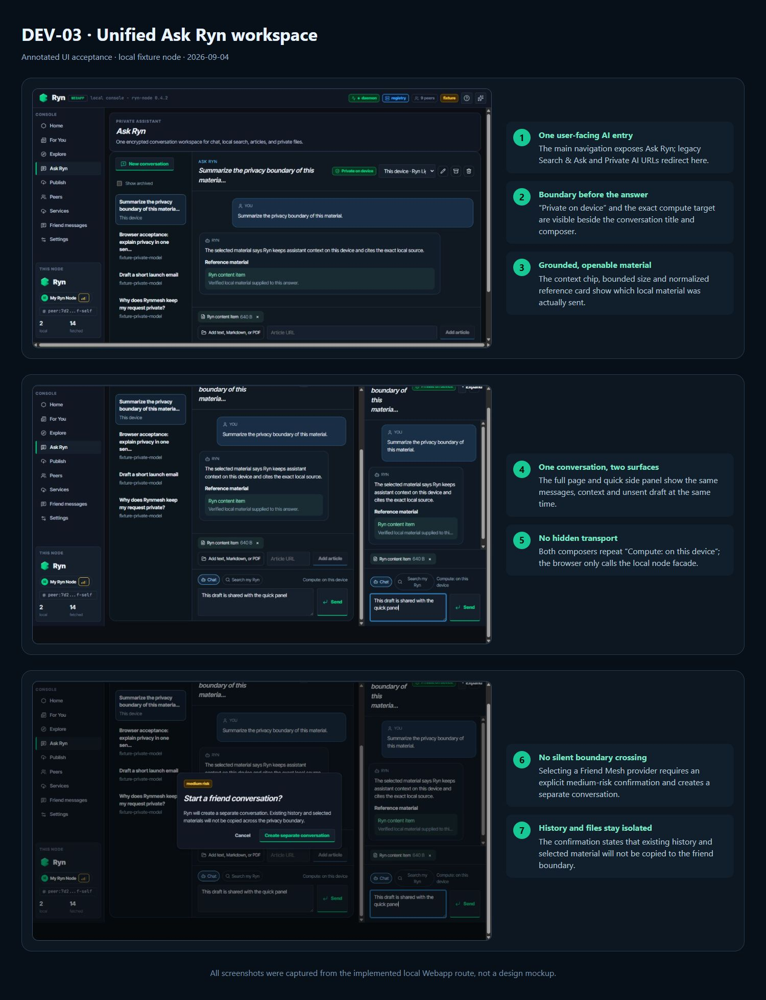

# DEV-03 Ask Ryn 验收记录

验收日期：2026-09-04

实现提交：`76cf331`

结论：通过自动化、浏览器 UI 与隐私负面验收；最终桌面壳回归纳入整套需求总验收。

## 已交付

- 主导航只保留一个 Ask Ryn AI 入口，旧 AI URL 定向到统一工作区；人与人聊天明确标为 Friend messages。
- 完整页面与快速侧栏共享 active conversation、草稿及持久化 run 结果。
- 支持本机普通对话、本地搜索、当前内容、Reader 文章、文本、Markdown、PDF 上下文。
- 会话 v2 使用现有 AES-GCM IndexedDB 存储；支持新建、继续、搜索、重命名、归档、删除与 50 条分页。
- Assistant Run 通过本地 node 门面执行，具备幂等、取消、失败重试语义和重启恢复。
- 本机与好友 Provider 是显式隐私边界；跨边界始终创建新会话并要求确认。
- 引用由 node 根据实际发送的 bounded context 生成并校验 locator。
- 设置页可导出不含正文的元数据，也可同时清理 node 运行记录与浏览器加密会话。

## UI 证据

标注说明：

1. 单一 Ask Ryn 入口与完整工作区。
2. 本机隐私状态与明确 compute target。
3. 真实本地材料与可打开引用。
4. 完整页与快速面板共享同一会话。
5. 两个输入框共享同一草稿。
6. 好友 Provider 选择是显式操作。
7. 跨隐私边界前创建独立会话且不复制历史/材料。

原始截图位于 `screenshots/01-grounded-conversation.png`、`02-shared-quick-panel.png`、`03-privacy-boundary-confirmation.png`。

## 验收条件映射

| 条件 | 结果 | 证据 |
|---|---|---|
| 一个 AI 入口完成普通/搜索/内容问答 | 通过 | 路由/UI + Assistant API 测试 |
| 快速侧栏与完整页共享状态 | 通过 | 注释 4、5；`AskRyn.test.tsx` |
| 无硬编码演示对话 | 通过 | 初始空态 UI 测试 |
| 会话 CRUD、恢复、500 条分页 | 通过 | UI/store 测试；固定 50 条页 |
| 文章、文本、Markdown、PDF | 通过 | context prepare API 与解析测试 |
| 引用落在实际发送范围 | 通过 | citation locator 测试；注释 3 |
| 取消、晚到结果与重启 | 通过 | 故障注入测试 |
| v1 会话迁移且不串 Provider | 通过 | migration store 测试 |
| Browser 只走 local node | 通过 | NodeClient API 边界与 facade 测试 |
| 跨隐私边界不静默复制 | 通过 | friend boundary 测试；注释 6、7 |
| 注入、多语言预算、明文泄漏负面项 | 通过 | `PRIVACY_NEGATIVE_REPORT.md` |
| 无写操作工具 | 通过 | Assistant provider 固定为只读系统约束，API 无写工具入口 |
| 全量质量门禁 | 通过 | `TEST_REPORT.md` |

## 已知边界

- Streaming 仍按批准范围留作后续增强；正式支持路径为可取消的非流式 run。
- 云 Provider 未启用；当前实现支持本机与显式 Friend Mesh target，不会静默降级到云。
- 桌面壳最终回归与全部五项需求一起执行，避免对每项重复打包安装。

## 回滚

- 设置 `RYNMESH_ASSISTANT_WORKSPACE_V1=0` 可关闭新的 node Assistant API。
- UI 回滚不会删除 v2 加密会话；旧 v1 记录迁移成功后仍保留。
- 可回滚提交 `76cf331`；不得执行会破坏用户其它工作树的 reset。
