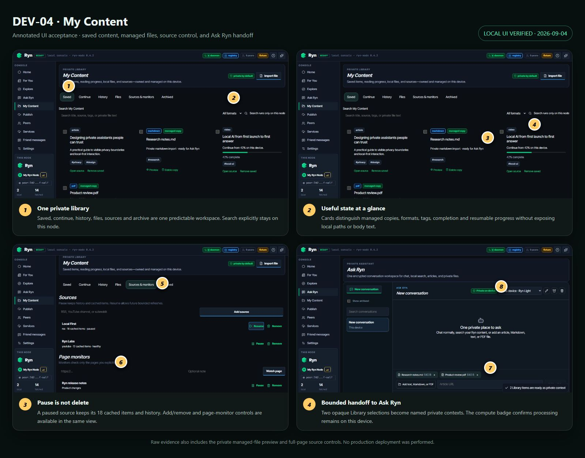

# DEV-04 My Content 验收记录

验收日期：2026-09-04

实现提交：`3dca95b`

结论：Windows 本地实现、自动化与浏览器 UI 验收通过；macOS 物理文件语义将在整套最终跨平台验收中单独记录。

## 已交付

- 单一 My Content 页面包含 Saved、Continue、History、Files、Sources & monitors、Archived。
- Library API 是 consumption、Digest、watcher、managed import 和 metadata 的分页投影，不复制已有真相数据。
- 搜索正文仅发生在 node；query 不写 URL，列表不返回正文、二进制或绝对路径。
- TXT、Markdown、PDF 导入复制到 Ryn 私有 managed storage；原文件永不修改。
- 文件限制 32 MiB、总配额 256 MiB、提取文本 2 MiB、PDF 500 页、解析 10 秒硬超时。
- 来源/页面监控支持 pause/resume；pause 保留历史与缓存并停止未来 fetch。
- 批量 archive、complete、Ask Ryn；最多 20 个 opaque Library IDs 进入 Assistant context prepare。
- export 默认仅含 metadata/import manifest，不含 managed bytes 或 extracted text；提供独立 erase scopes。

## UI 证据

原始截图：

- `01-saved-library.png`：收藏、进度、格式、managed copy 和本机搜索。
- `02-sources-monitors.png`：来源暂停后保留 18 条缓存、恢复/删除及 page monitor。
- `03-private-file-preview.png`：私有 managed copy 的应用内预览。
- `04-library-ask-ryn.png`：两个 Library 项以 opaque ID 交给本机 Ask Ryn。

## 验收条件映射

| 条件 | 结果 | 证据 |
|---|---|---|
| 一个页面覆盖六类视图 | 通过 | UI 注释 1；MyContent UI test |
| 收藏刷新后进入 Library | 通过 | consumption lazy projection test |
| 进度、完成、重新开始 | 通过 | Library action test；UI 42% progress |
| 搜索/筛选/cursor 无重复遗漏 | 通过 | 130 条三页一致性；filter-bound cursor |
| 来源 pause/resume 保留历史 | 通过 | Digest fetch negative test；UI 注释 5、6 |
| TXT/Markdown/PDF 安全导入 | 通过 | import tests；private preview |
| 多项内容交给 Ask Ryn | 通过 | race regression test；UI 注释 7、8 |
| 删除 managed copy 不删原文件 | 通过 | Windows 原文件前后 bytes 一致 |
| 列表/URL/日志不泄漏路径/正文 | 通过 | `SECURITY_NEGATIVE_REPORT.md` |
| 全部大小/页数/时间/batch/query/limit 有界 | 通过 | constants、API gates、negative tests |
| export/erase 覆盖 Library 数据 | 通过 | HTTP privacy integration test |
| 10,000 条性能 | 通过 | `SCALE_REPORT.md` |
| 质量门禁 | 通过 | `TEST_REPORT.md` |

## 回滚

- Backend：设置 `RYNMESH_LIBRARY_WORKSPACE_V1=0`。
- Webapp：设置 `VITE_RYN_LIBRARY_WORKSPACE_V1=0` 后 `/library` 回到旧 Digest UI。
- Library 是 lazy projection，回滚不改写 consumption/source/watcher 数据。
- Managed imports 和 metadata 在回滚后保留；只有用户显式 erase/delete 才移除。
- 本地回滚提交为 `3dca95b`，不执行会影响其它工作树的 destructive reset。
