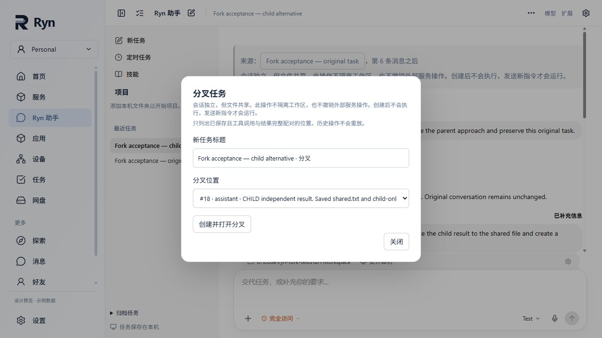
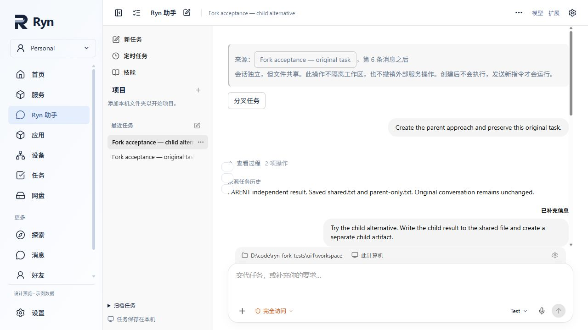
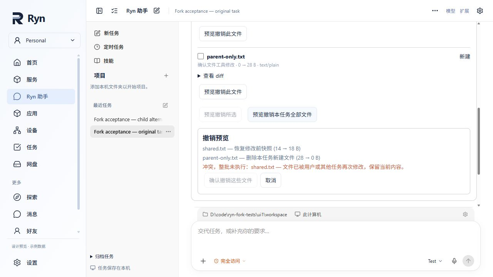

# Task fork acceptance — 2026-10-30

This implements a shared-workspace conversation fork, not a filesystem branch or an OS sandbox. Evidence below is from the development UI, installed HTTP routes, real encrypted task storage, real temporary Git repositories and production local file tools. The model transport uses deterministic fixed responses; no paid model was called.

## Implementation and ownership

- Reuses `AgentStore` encrypted task snapshots and atomic root commit; no second conversation database. `task_forks.py` installs owner-only boundary and creation endpoints.
- The boundary scanner admits only persisted prefixes with complete assistant/tool-result pairs in matching context epochs. Prefix tokens also bind model, scope, workspace and conversation revisions. A running parent's later append does not invalidate an earlier unchanged prefix.
- Builds a fresh child from an explicit configuration allowlist. Queues, in-flight requests, one-shot approvals, input requests, receipts, processes, callbacks, provider sessions, subagents, usage and verification authority are not inherited. Full retained message history carries previous goals, corrections and progress. A checkpoint is retained only when its covered prefix is included.
- Attachments are checked against their recorded size/hash and copied to the child's attachment directory. Reachable encrypted large results are verified and copied/resealed under the child's namespace. Result IDs stay usable, including nested references. Original attachment paths in messages/checkpoints/goals/results are replaced consistently. Limits: 40 MiB of referenced plaintext and 256 copied files per request; uploads retain their existing 10 MiB individual limit; the child record retains the existing 2 MiB admission bound.
- Permission mode is the intersection of parent and current settings; desktop access is intersected too. Existing workspace/project/resource validation remains authoritative. No live queue is created. Both resume and worker admission reject an initial fork until a new owner message arrives.
- Creates are idempotent using the existing request index/tombstones. Browser retries retain the exact request in session storage. Reference writes precede the root commit, use a deterministic child namespace and refuse to overwrite changed staging files. Interrupted copies can be reused by the same request after restart; no child is listed before the root commits. Uncommitted bytes can remain after process death, but are not exposed as a successful task.
- The file-review journal/baseline is not cloned. Parent edits remain parent-owned. Inherited reply text is labeled as source history and does not auto-link filenames to the child's newer artifacts.

## Actual development UI run

Backend: `scripts/fork_dev_acceptance.py --home D:\code\ryn-fork-tests\ui1 --port 19787`.
Vite: `VITE_RYN_NODE_BASE_URL=http://127.0.0.1:19787/api/local`, port 15173, `/agent?client=fixture`.
Only the surrounding node shell uses fixture data. Agent HTTP routes, worker, durable store, file tools and disk changes are real. Chrome CDP timed out; the complete interaction was performed in the in-app browser.

1. Opened **Fork acceptance — original task**, whose production file tools had written `shared.txt` and `parent-only.txt`.
2. Opened **分叉任务**, inspected the complete saved boundaries (#1, #3, #5, #6), entered **Fork acceptance — child alternative**, and created at #6.
3. Child opened with source navigation, boundary and shared-files notice. Direct encrypted-store inspection found the parent record exactly unchanged, child paused with six messages, and model-call log still at three calls (the parent's original run only). Child had no inherited file-review entries.
4. Sent a new child instruction through the UI. The worker wrote `shared.txt = "child result\n"` and `child-only.txt`; the child produced its independent result. The parent record and `parent-only.txt` were unchanged.
5. Used the source button to return to the original. Opened file review and batch undo preview. The API/UI reported conflict on `shared.txt`, the confirm button was disabled, and the entire batch remained unapplied. Disk inspection confirmed the child content and both independent files intact.
6. Stopped the backend process, restarted against the same encrypted store, reloaded the UI, and reopened the child. History, provenance and result survived. Sent another child instruction from the UI and obtained another independent result. Parent record remained byte-equivalent as parsed JSON; child had 18 messages; model-call log had nine calls (three rounds of three fixed responses).
7. Rechecked the parent's conflict preview after restart.

`disk-verification.json` records task IDs, message counts, model-call count and file contents/hashes. Screenshots document the UI states; they are supplemental to the actual operations and disk assertions.

## Tests executed

- Installed HTTP/API and disk tests in `tests/test_agent_task_forks.py`: history copying, immutable parent, complete/malformed/incomplete tool pairing, context epochs, stale boundary, safe running-prefix fork, no replay, fresh provider conversation key, independent parent/child runs, actual child file writes, current read-only enforcement, workspace changes, resource revocation, source-bound reference rejection, nested forks, attachments, encrypted large results, checkpoint boundaries, missing references, storage limits, path escape, Windows junction, idempotency, root-write failure, mid-copy failure, actual subprocess `os._exit(73)`, restart/retry, user-modified staging conflicts, and parent/child undo ownership/conflict.
- Related Python regression: `test_agent_runtime_model_switch.py`, `test_agent_file_changes.py`, `test_agent_input_attachments.py`. The combined run before the final additional fork cases passed **58 tests**. The final fork-only run passed **16 tests** in 78.08 seconds.
- UI component checks: `RynAgentFork.test.tsx` and `RynAgentRecords.test.tsx`, **13 passed**, including uncertain-response retry across remount/reload. These supplement the actual UI flow above.
- `npm run lint` passed. `npm run build` passed (existing large-chunk and mixed Tauri notification import warnings).
- Test infrastructure limitations: default pytest temp-directory cleanup hit a preexisting Windows permission error, so successful runs used explicit fresh `D:/code/ryn-fork-tests/...` basetemps. Initial Vitest fork workers timed out; the passing run used `--pool=threads --maxWorkers=1 --no-file-parallelism`. A broader task-page component run stalled with unhandled `/agent/automations` mocks and was stopped; it is not counted as passed.

## Limits and merge notes

- Workspace files are shared. Forking does not preserve a filesystem version or roll back external services.
- Task-bound external resource handles and desktop-observation artifacts currently fail closed with an explicit error; users can choose an earlier boundary. Portable uploads, encrypted large output and covered checkpoints are retained. Parent-owned output-file receipts are deliberately not reissued as child receipts; existing workspace files remain readable under current workspace permissions.
- A model switch uses the existing destination-confirmation/context-epoch workflow; incompatible previous-provider history is excluded from the new provider projection. Real provider inference and the packaged desktop application were **not** tested. The web production build is not packaged-desktop acceptance.
- Common-file edits are limited to `runtime.py` (public fork metadata, new-message gate release, resume/worker gate), `control.py` (allowed actions), `routes.py` (route installation), `webapp/src/domain/rynAgent.ts` (metadata types), and `webapp/src/screens/RynAgent.tsx` (component/provenance rendering). Review these when merging with the separate compaction work.
- No edits to `loop.py`, compaction algorithms, prompts, budget strategies or PTY. Work stays on `codex/task-change-review`; no merge is performed.
