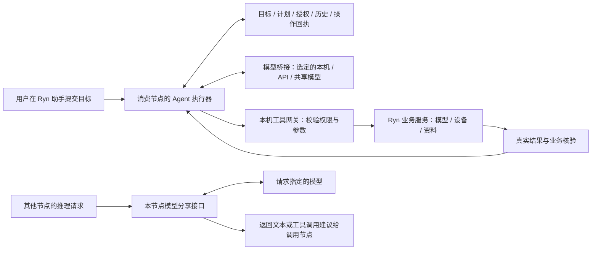
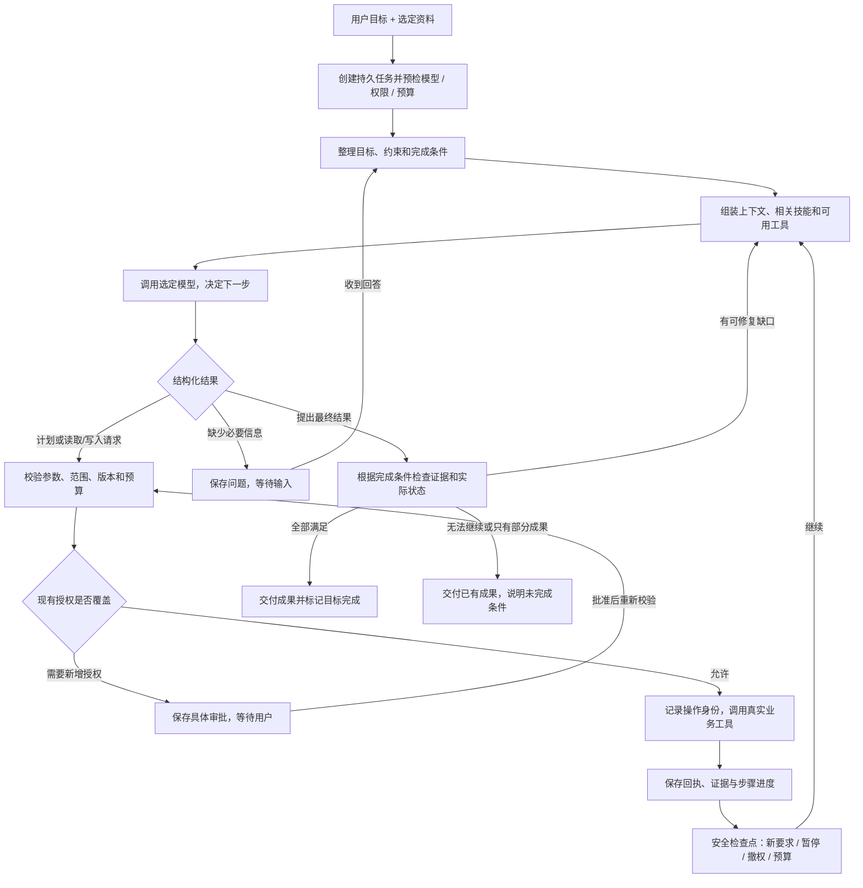

# Ryn Agent 完整执行流程与实现对应

日期：2026-10-09。本文补充 [交付计划](ryn-agent-delivery-plan.md) 中未展开的执行主线。下文“目标流程”是待完成设计，不代表已经实现；当前代码只具备其中部分机制。

## 1. 整体架构与两条调用路径

Ryn Agent 采用一个消费节点上的主控执行循环。模型理解目标、提出计划和下一步动作；Ryn 后端负责权限、调度、持久记录、调用业务服务和检查结果。页面负责输入与展示，关闭页面不应丢失任务。节点进程退出后不能继续执行，重启需核对现场再恢复。



最后一条分享路径不进入本节点的 Agent 执行器，不附加本节点的任务、记忆、Skills，也不执行调用方提出的工具。调用方可以把自己的历史和工具定义放进推理请求，由调用方保存状态及执行工具。模型提供方能处理调用方主动发送的内容，“无状态”不等于看不到请求数据。

默认主控模型、是否启用助手、每个模型的分享规则是三份独立设置。改变默认模型只影响新任务；既有任务切换模型要走安全检查点及数据发送范围检查。提供节点关闭助手后，模型分享仍应可用。

## 2. 从一句要求到交付的主流程



图中等待授权、等待输入、暂停、未知写入结果都不是成功。审批拒绝时返回明确“未执行”，由模型在已有权限内调整方案，不能不停索取同一授权。异常分支和恢复规则见第 5 节。

### 步骤 1：接收要求并创建任务

界面提交目标、资料引用、所选模型及任务设置。服务端验证用户身份，以请求 ID 去重，先保存任务再排队。资料引用使用受控连接/资源 ID 和版本，不接受模型猜出的路径作为已授权文件。

预检包括助手是否启用、模型是否支持工具调用、当前模型去向、允许读取/新建的范围以及预算。模型不可用时保留要求并提供可操作原因，不静默切换到另一提供方。用户只问普通问题时可以直接回答，不强制工具、计划或审批。

### 步骤 2：明确目标、约束和完成条件

把用户原话完整保留，再形成可更新的结构：要做什么、有哪些不能违反的约束、产出在哪里、怎样判断做完。例如“生成报告并存到周报目录”至少需要文件实际存在、保存位置正确、来源和必需内容可核对。

模型可以帮助提出这些条件，但不能擅自删去原要求或降低完成标准。简单请求内部只保留必要字段；复杂请求展示简短计划，通常先发现资料，再处理，再保存和核验。不为所有任务增加一次固定“规划模型”调用，同一主控可在正常轮次提交计划。

只有缺少会影响结果的必要信息才询问用户；可合理确定的细节采用明确假设继续。等待输入独立于等待授权，回答一个问题不会自动授予新的数据访问或写入权限。

### 步骤 3：准备本轮上下文

上下文按层组装：版本化产品规则、当前目标及最新约束、执行环境与模型去向、相关技能与明确保存的偏好、当前可用工具、最近消息和必要证据。

工具和资料按需要加载，先目录/元数据，再读相关内容；大结果保存为可回读引用。即使未把某工具放进本轮提示词，服务端权限检查仍是最终约束；即使摘要或 Skill 写了“允许执行”，也不能新增权限。

接近模型上下文上限时先压缩，保留最新更正、未做步骤、资源版本及操作回执。摘要用于帮助继续工作，授权记录和真实证据独立保存。压缩失败或预算不足则停止新增调用并保留现场。

### 步骤 4：模型提出下一步

模型桥接把本轮上下文和工具定义传给当前模型，把不同供应方响应转换成统一格式。循环处理四类提议：

| 提议 | Ryn 如何处理 |
| --- | --- |
| 更新计划 | 验证结构并保存简短步骤；不能凭文字把未执行步骤标成已验证 |
| 调用业务工具 | 验证工具名、参数、目标范围与版本，再交工具网关 |
| 请求必要输入 | 保存问题 ID、关联约束版本及可选答案，等待用户回复 |
| 提交最终结果 | 进入核验，不直接把模型结束映射为任务成功 |

计划、提问、交付采用受控内部动作或结构化工具协议，具体接口在 T02 定稿；不靠中文关键词识别“完成”“批准”。格式错误可以在预算内返回可修正信息；未知工具、无权访问等不能凭模型解释放行。

### 步骤 5：工具网关执行真实操作

工具注册信息包含参数结构、读写性质、资源范围、超时、重试规则、结果查询方式及核验方法。模型仅提出动作，执行器决定能否派发。

执行前核对当前任务约束版本、权限、业务资源版本和预算。已经授权的范围内可连续执行；只有超出授权或策略要求确认的动作才显示具体审批。审批绑定目标、参数、影响及版本，批准后还要在实际业务写入前重验。

每个写操作在派发前持久记录操作 ID 和意图。调用业务服务后保存结果、实际副作用及可查询证据。外部服务无法与本机记录组成一个原子事务，所以“请求已发出但回执未知”必须单独处理，不能当失败重发。

有依赖关系或同一资源上的写操作按序执行。第一阶段可全部串行；后续仅对独立、只读、有界的操作并行，不为了速度引入生产子 Agent 协作。

### 步骤 6：根据观察继续，而不是每一步都等用户

工具回执返回模型，计划步骤关联真实证据，然后再次组装上下文、调用模型。执行器在每轮和实际写入前处理新要求、暂停、撤权及预算。

只读瞬态错误可有界重试；参数错误返回模型修正；无权限需按规则补授权或换方案；不支持的格式需明确遗漏。重复执行同样失败动作又无进展时停止循环，说明具体阻塞，避免无限消耗。

### 步骤 7：核验、交付及后续续做

模型提出完成只是开始核验。核验分三层：

1. 执行事实：操作是否实际发生，有没有未知结果、拒绝或失败。
2. 业务结果：文件能否读回，配置是否生效，分享范围是否正确，要求的产物是否齐全。
3. 内容质量：报告必需事实、引用和用户约束是否满足。可用确定规则的先用规则；模型辅助检查不能冒充客观正确性保证，无法核验的条件明确保留。

能修复且权限/预算允许时回到循环；缺必要信息转等待输入；有部分产物却无法全部完成时交付已有成果和未满足条件；只有必需条件均满足才能标目标完成。纯问答可以正常结束，不伪造业务工具回执。

最终结果来自真实成果引用和执行证据，显示可打开文件、已生效变更、未完成内容及原因。结束后用户可在同一任务追加要求，形成新的轮次；历史成果、操作记录和旧目标版本保留。用户取消的旧运行不能自动复活，新一轮须有明确继续请求及状态检查。

## 3. 哪些状态必须持久化

下表为拟议逻辑对象，具体存储方式由 T02/T10 定稿；不是要求一次创建十套独立数据库。

| 对象 | 保存什么 | 为什么需要 |
| --- | --- | --- |
| Task / Turn | 原目标、当前约束版本、轮次、当前模型、执行节点 | 中途补充不丢原目标，换模型有记录 |
| Plan / Criteria | 步骤、完成条件、关联证据、未完成原因 | 分清“打算做”与“已经核验” |
| Scope / Approval | 允许的资源和动作、具体审批及版本 | 模型文字不能替代权限 |
| Messages / Input | 消息、待答问题、用户更正及生效状态 | 刷新/重启后继续，过期回答不误触发 |
| Operation | 操作 ID、参数摘要、目标版本、派发与回执状态 | 未知结果可核对，防止重复写 |
| Evidence / Artifact | 工具结果引用、资源版本、成果位置和核验结果 | 大结果可回读，最终交付有依据 |
| Budget | 调用预留、实际消耗、本轮和任务累计 | 重启及摘要调用不漏账 |
| Event | 有序事件及 UI 读取位置 | 页面断线后补齐进展，无需猜测状态 |

运行状态和结果状态分开：运行中、排队、等待输入、等待授权、暂停、核对未知结果、已结束，描述执行器在做什么；未核验、核验通过、部分完成、未达成、结果未知，描述目标结果。实际枚举和兼容迁移由 T02/T04 定稿，旧 completed 不能直接迁移成“目标核验通过”。

UI 增量事件序号与影响执行的控制版本分开处理，避免一段新文本就让停止请求过期。服务端返回允许的动作和不能操作的原因，前端不独立猜状态机。

## 4. 主循环的实现骨架

以下是目标伪代码，不是已落地代码。一个任务同一时刻只有一个有效执行租约；持久事务保持短小，模型和外部业务请求在事务之外执行。

```text
领取一个可运行任务，校验执行租约
处理待生效的用户更正、暂停、取消和撤权
如果有未知写入：进入结果核对，不派发后续依赖操作
如果在等待输入或授权：保存状态并让出工作器
如果预算/存储不足：保存现场，停止新增派发

如果存在待执行动作：
    核对目标/约束版本、参数、资源版本、权限和预算
    如需新增授权，保存审批并让出工作器
    保存操作身份及派发状态
    调用真实业务服务
    保存成功/未执行/未知结果和可查询证据
    回到安全检查点
否则：
    组装上下文，必要时做有界压缩
    预留模型调用预算，记录本轮目标版本
    请求选定模型，传递正文增量事件
    结算预算，检查响应是否已被暂停/更正淘汰
    验证结构化动作，保存计划/问题/工具队列/最终结果提议
    最终结果提议进入核验，其余回到安全检查点

核验缺口可修复且有进展：继续循环
核验通过：保存真实成果并结束
无法继续：保存部分成果/阻塞/未知状态并结束或等待
释放租约，工作器可以服务其他任务
```

目标版本改变后，旧模型输出不能派发新动作；已发生的工具副作用不能当作不存在，仍保存真实回执。模型提供方支持取消时尝试取消请求，不支持时停止采用其晚到动作，并如实记录可得调用消耗。

## 5. 中途纠正、错误与重启的分支

| 情况 | 目标处理流程 |
| --- | --- |
| 执行中补充“不要分享，只检查” | 先保存新要求，增加控制/约束版本；阻止旧未执行写入，废止相关旧审批；在途写入收取回执；更新计划再继续，UI 明确要求何时生效 |
| 暂停 | 停止后续派发；保存当前步骤和在途状态；用户继续时先检查最新权限、资源和待核对结果 |
| 取消 | 不再派发新操作；在途写入可能已经完成，保存其晚到回执；不承诺回滚，不自动重启旧运行 |
| 审批被拒 | 返回明确未执行结果；在现有范围内调整，或说明无法完成，不能无限弹同一审批 |
| 只读超时 | 按工具规则有界重试；多次失败则缩小范围、换可用方式或报告阻塞 |
| 写入超时 | 如果有确定未执行证据可纠正；否则先查询原操作/目标，不自动重放 |
| 节点重启 | 检查持久操作记录：未派发可重验后继续；已完成使用原回执；已派发无结果先核对；不能确认则等待处理 |
| 模型/来源掉线 | 保留现场，说明来源问题；不静默把资料发给另一模型提供方 |
| 上下文超限 | 持久化大结果并按引用取片段，压缩上下文；仍超限则说明限制并停，不丢约束硬续跑 |
| 长期无进展或预算耗尽 | 停止新增调用，交付已有成果与具体未完成条件；用户可明确调整预算或要求后再继续 |

用户更正的边界以服务端记录和业务派发顺序为准：收到更正时已经提交给远端业务的写入不能保证撤回。审批绑定的旧版本失效，不代表撤销已经发生的修改。

未知结果核对应优先查询原操作 ID 与业务回执；目标当前“看起来相同”不一定能证明某次非幂等操作是否发生。只有业务工具提供足够证据才能判定已执行或确定未执行，否则保持结果未知，不能凭模型猜测继续写入。

## 6. 用一个任务贯穿整个流程

示例目标：“把项目资料中的本周进展整理成周报，存到周报目录；不要修改原文件。”这是贯穿验收目标。文件读取、搜索、新建与读回工具现已接入；完整场景的真实模型重复验收仍未完成，进度以交付验收记录为准。

1. 用户选择资料和目标目录。任务保存读取范围、新建范围、禁止修改原文件、当前主控模型及数据去向。
2. Agent 建立简短计划和完成条件：找到相关资料、核对内容、生成报告、保存、读回检查。
3. 调用能力/目录工具，发现资料与格式；在授权范围搜索本周内容，按需读取多份资料。
4. 某份资料读取超时，按规则重试；仍不可读时记录遗漏，不声称读完。
5. 用户补充“客户名称匿名”。服务端保存更正，使尚未执行的旧生成/保存动作失效；后续生成遵守最新约束。
6. Agent 生成内容，调用新建文件工具。目标目录内的新建若已获授权可连续执行；同名冲突不能静默覆盖原文件。
7. 实际读取新文件，核对位置、必需内容、来源、匿名要求及原文件未被修改的证据。
8. 全部条件满足则交付真实文件入口；资料缺失导致条件不全，则显示部分完成和遗漏，而非只发一句“已生成”。

这个任务应包含至少 5 次有意义工具操作。模型、工具和持久状态共同支撑流程，不能用预设回答拼成成功演示。相同框架也用于“配置来源”和“诊断设备”，只替换业务工具与核验条件。

## 7. 开始实施时的代码基线（历史记录）

以下表格保留立项时的审计，不能用作当前完成清单。目标/计划、控制版本、中途输入、资料范围、核验、未知写入恢复与界面已有后续实现，详细证据和未通过项见 [交付验收记录](../acceptance/ryn-agent-delivery/README.md) 及 [控制器清单](../acceptance/ryn-agent-delivery/cases-collectors-v1.json)。测试通过和开发试跑均不等于最终验收通过。

| 流程环节 | 当前代码/事实 | 后续任务 |
| --- | --- | --- |
| 入口、任务创建、事件读取 | routes.py 已有创建/详情/消息/动作/事件接口；store.py 已有加密事务存储 | T02/T10 扩展目标、控制和存储对象 |
| 调度和模型—工具循环 | runtime.py 的 run_once 已调度排队任务，_model / _tool 交替执行 | T02/T03 加入完整控制检查点及目标版本 |
| 模型桥接 | bridge.py 复用现有来源及共享推理路径 | T01/T09 做真实兼容和模型变更规则 |
| 上下文 | _context / _compact 有单任务压缩 | T02/T10/T11 实现分层上下文、引用、技能与偏好 |
| 工具校验和审批 | 已有参数检查、具体写审批、执行前撤权复查；仅 5 个窄工具 | T05–T09 扩展资源范围和业务闭环 |
| 中途纠正 | add_message 目前拒绝运行中任务，某些暂停队列也不能追加 | T03 实现输入排队、生效版本和旧动作失效 |
| 完成判断 | _model 当前没有 tool_calls 即设置 completed；UI 只称“本轮结束” | T04 增加核验、部分完成与真实成果 |
| 故障恢复 | reconcile 保留待审批；未知写入中断不重放 | T04/T10 增加查询结果、核对后恢复与容量管理 |
| 页面 | 基础独立工作区、事件和审批已有 | T13/T14 按实际状态与成果补交互，不另改已认可布局 |

这里不能省略的主要缺口是：持久目标与计划、输入生效和动作失效机制、资源权限、业务工具、核验与交付。已有模型循环只是主流程中间的一部分。

## 8. 流程如何验收与安排

T01 先用真实模型验证当前调用链能持续执行；T02–T05 把完整状态流和控制边界建立起来；T06–T09 接入业务并提供各自核验器；T10–T14 补长任务和界面；T15–T17 按原计划做两机、效果和桌面验收。

增加一条贯穿验收：同一个真实模型任务必须依次经历创建目标、发现资料、至少 5 步执行、用户中途更正、一次可恢复失败、写后核验、真实成果交付；刷新页面后计划和证据仍一致。另做写入回执丢失及重启用例，验证不重复写。正常路径、等待输入、审批拒绝、部分完成和预算停止分别留完整记录，不能只测顺利演示。

核心执行流程、状态与权限仍由 Astra high 负责；Sol high 负责稳定契约上的 UI 和固定流程测试。当前仍为单主控 Agent，本流程不额外增加多 Agent 产品功能。
